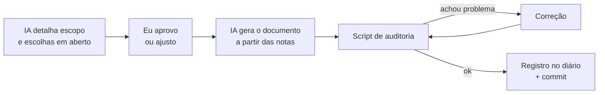

# Da Reunião ao Documento: Design Docs do Sistema de Webhooks de Notificação de Pedidos

> Este README documenta **o processo de produção** do pacote de design docs. O enunciado original está no [repositório base](https://github.com/devfullcycle/mba-ia-desafio-design-docs-com-ia) e há uma cópia em [`notas/enunciado-original.md`](notas/enunciado-original.md).

## Sobre o desafio

O ponto de partida era uma aplicação real de Order Management System (Node.js + TypeScript + Prisma/MySQL) e a transcrição literal de uma reunião de ~55 minutos ([`TRANSCRICAO.md`](TRANSCRICAO.md)) em que tech lead, PM, dois engenheiros e a engenheira de segurança decidiram como construir um sistema de webhooks para avisar clientes B2B sobre mudanças de status de pedidos. Nada tinha sido registrado além da conversa. A tarefa foi transformar essa conversa, junto com o código, em um pacote de documentação acionável — PRD, RFC, FDD, ADRs e um tracker de rastreabilidade — sem alterar uma linha da aplicação.

A dificuldade real não era escrever, e sim **filtrar**: a reunião mistura decisões fechadas, sugestões descartadas, pontos adiados, correções no meio da fala (o `customer_id` "do JWT" que é desmentido um minuto depois) e números ambíguos (as "5 tentativas" cujo backoff só fecha com 6 envios). O objetivo do processo foi garantir que **cada linha da documentação tivesse origem identificável** — uma fala `[hh:mm] Nome` ou um arquivo real do repositório — e que tudo o que a reunião não fechou aparecesse explicitamente como proposta ou interpretação, nunca como fato.

## Ferramentas de IA utilizadas

| Ferramenta | Papel |
|---|---|
| **Claude Code** (extensão do VS Code, modelo Claude Opus 5.5) | Ferramenta principal: clonou o repositório, leu o código e a transcrição, montou o plano, extraiu e classificou as falas, mapeou os pontos de integração no código, redigiu os documentos e escreveu os scripts de auditoria. O plano inicial era usar o Claude Code no terminal; optei pela extensão do VS Code para revisar diffs e abrir os documentos lado a lado com a transcrição |
| **`CLAUDE.md`** (memória de projeto do Claude Code) | Prompt persistente com as regras do desafio, as armadilhas da transcrição e as convenções de IDs, carregado automaticamente em toda conversa — garantiu consistência entre as fases mesmo trocando de sessão |
| **Scripts Bash gerados pela IA** | Auditoria automática ao fim de cada fase: timestamps citados × transcrição, caminhos citados × repositório, links relativos, seções obrigatórias, contagens mínimas e percentuais do tracker |
| **Mermaid** | Diagramas de componentes (RFC) e de sequência (FDD), renderizados pelo próprio GitHub |

## Workflow adotado

### Princípios

1. **Nada sem origem.** Toda afirmação cita `[hh:mm] Nome` ou um caminho de arquivo; o que não tem origem não entra, ou é marcado como proposta.
2. **Cada documento numa altura.** PRD = por quê/o quê; RFC = proposta e alternativas; ADR = uma decisão; FDD = como construir; Tracker = de onde veio.
3. **Extrair antes de escrever.** Nenhum documento foi gerado direto da transcrição: primeiro veio uma matriz classificada e um mapa do código, e todos os documentos foram escritos a partir deles.
4. **Gate humano por fase.** Antes de cada fase, a IA apresentava o escopo e as escolhas que a reunião não fechava; eu aprovava ou ajustava antes de qualquer geração.
5. **Auditoria automática + registro.** Ao fim de cada fase, script de verificação, correções, registro no diário e commit.

### Fases

| Fase | Entrega | Commit |
|---|---|---|
| 0 | Setup: `CLAUDE.md`, plano e diário do processo; branch `docs/design-docs-webhooks` | `dfac485` |
| 1 | Matriz da transcrição (97 itens + 12 lacunas) e mapa do código (49 fatos com linha) | `a958945` |
| 2 | 7 ADRs + índice | `bdc0344` |
| 3 | RFC | `27a692b` |
| 4 | FDD | `5f0424c` |
| 5 | PRD | `972a436` |
| 6 | Tracker (228 linhas) | `f99b257` |
| 7 | Este README | — |
| 8 | Revisão final contra a checklist de aceite | — |

A ordem seguiu a sugestão do enunciado — **ADRs primeiro** (as decisões são o esqueleto), depois RFC (consolida e aponta alternativas e questões em aberto), FDD (detalha sobre decisões já fechadas), PRD (consolidação em linguagem de produto) e, por último, Tracker e README.

### Ciclo de cada fase



### Organização da interação com a IA

- **[`CLAUDE.md`](CLAUDE.md)** — regras absolutas (não tocar no código, nada sem origem, marcar arquivos novos como "a criar"), altura de cada documento, convenções de IDs e 10 armadilhas da transcrição.
- **[`notas/matriz-transcricao.md`](notas/matriz-transcricao.md)** — fonte única da transcrição: cada fala relevante classificada (decisão, requisito, alternativa, fora de escopo, questão em aberto, armadilha) com timestamp e destino.
- **[`notas/mapa-codigo.md`](notas/mapa-codigo.md)** — fonte única do código: pontos de integração com arquivo e linha, e lacunas do código (sem tracing, sem métricas, sem vínculo usuário ↔ cliente).
- **[`notas/plano.md`](notas/plano.md)** e **[`notas/processo.md`](notas/processo.md)** — status das fases e diário com cada prompt, o que a IA entregou, o que estava errado e como foi corrigido.
- **Uma conversa por bloco de fases**, com o contexto reconstruído a partir do `CLAUDE.md` e das notas quando a conversa era reiniciada.

## Prompts customizados

### 1. Planejamento — pedir estratégia antes de qualquer documento

```
ok com base no readme que é a descrição do desafio quero montar com voce a estrategia
pra gente seguir e assim cumprir o desafio. Vou usar o claude no terminal para fazer os
passos necessarios. portanto analisando a descrição gere pra mim um plano de execução
para que possamos entregar o desfio
```

Em vez de pedir "gere um PRD", o primeiro prompt pediu um **plano**. Isso fez a IA ler a transcrição inteira e o código antes de produzir qualquer coisa, e já no planejamento ela apontou as armadilhas (correção do `customer_id`, Diego entrando só às 09:05, prazo com duas versões) que viraram regras.

### 2. Prompt persistente de projeto — trecho do `CLAUDE.md`

Redigido com a IA na Fase 0 e ajustado ao longo do trabalho; é carregado em toda conversa.

```markdown
## Regras absolutas
3. **Nada sem origem.** Todo requisito, decisão, restrição, número ou trade-off escrito
   nos documentos precisa ser rastreável a:
   - uma fala da transcrição → citar como `[hh:mm] Nome` (ex.: `[09:17] Diego`), ou
   - um arquivo real do código → citar o caminho.
   Se não houver origem identificável, **não escreva** — ou sinalize explicitamente
   como lacuna para o usuário decidir.
4. **Antes de citar um timestamp**, confira na transcrição que a fala existe naquele
   minuto e que o falante está correto.
5. Arquivos que a feature vai criar devem aparecer sempre marcados como
   **"(novo, a criar)"** — nunca como se já existissem.

## Armadilhas conhecidas da transcrição
1. **customer_id NÃO vem do JWT.** Marcos sugere isso em `[09:31]`, mas é corrigido...
5. **Fora de escopo / adiado — não podem virar requisito:** e-mail de alerta, dashboard,
   arquivamento após ~30 dias, webhooks de entrada, ordering global / múltiplos workers.
9. **Não inventar métricas.** O "99% dos casos" ([09:25] Diego) não é um SLA.
```

### 3. Gate de fase — escopo e decisões antes de gerar

Usado no início de cada fase da 1 à 6:

```
sim me detalhe a fase 4 antes de seguir
```

A IA respondia com a estrutura do documento e uma tabela de escolhas que a transcrição não fechava, cada uma com recomendação e justificativa. A aprovação era explícita e referenciava cada escolha:

```
aprovo D-1 a D-6, pode seguir e fazer o commit no final
```

Exemplo de escolha levada ao gate do FDD (D-3): a reunião diz que a URL `https` é validada "no schema Zod" ([09:23] Sofia) e que o erro é `WEBHOOK_INVALID_URL` ([09:28] Bruno) — mas o `validate.middleware` do projeto transforma qualquer erro Zod em `VALIDATION_ERROR`. Decisão aprovada: aplicar o schema dentro do service.

### 4. Extração dirigida da transcrição (Fase 1)

Instrução de trabalho da matriz, definida no plano e aprovada antes da extração:

```
Classifique cada fala relevante em categorias fechadas: DEC (decisão principal),
DEC2 (secundária), RF, RNF, RES (restrição), ALT (alternativa descartada, com o motivo),
OOS (fora de escopo/adiado), OQ (questão em aberto), TRD (trade-off), CTX, ARM (fala
corrigida depois ou que não deve ser usada como fato). Sempre com [hh:mm] Nome.
Rastreie cada decisão até a fala que a FECHA, não só a que a propõe. Separe o que foi
sugerido do que foi decidido. Ao final, liste as lacunas: pontos que a reunião deixou
ambíguos, com uma recomendação de tratamento para eu decidir.
```

### 5. Autoauditoria ao fim de cada documento

```
Liste toda afirmação deste documento sem fonte identificável. Confira por script:
todo [hh:mm] Nome citado existe em TRANSCRICAO.md com esse falante; todo caminho citado
existe no repositório ou está marcado "(novo, a criar)"; todo link relativo resolve;
seções obrigatórias presentes; contagens mínimas do enunciado atingidas.
```

## Iterações e ajustes

O trabalho teve **9 fases, cada uma com um ciclo principal** (escopo → aprovação → geração → auditoria → correção). Nenhum documento precisou ser regenerado do zero, porque os erros de interpretação foram resolvidos **antes** da geração — na matriz (Fase 1) e nos gates de cada fase. As correções abaixo foram as principais:

| # | Fase | O que a IA fez de errado ou superficial | Como foi corrigido |
|---|---|---|---|
| 1 | 1 | Citou `src/worker.ts` e `webhook.worker.ts` sem a marca "(novo, a criar)" — violaria o critério "nenhum arquivo inexistente citado" | O script de caminhos detectou; marcação adicionada e regra reforçada no `CLAUDE.md` |
| 2 | 1 | A leitura direta de "5 tentativas, backoff 1m/5m/30m/2h/12h" ([09:17]) daria 5 envios — mas 5 intervalos somam 14 h 36 min, o "quase 15 horas" de Diego, o que só fecha com **1 envio + 5 retentativas** | Registrado como lacuna L-01, decidido no gate e escrito no ADR-003 como interpretação explícita, com tabela de tempos |
| 3 | 1 | O limite de 64 KB ("erra", [09:23]) aplicado na gravação da outbox desfaria a mudança de status do pedido por causa do webhook — contradiz [09:40] Bruno | Lacuna L-02: validação movida para o worker (DLQ direto) e levada ao RFC como questão em aberto |
| 4 | 2 | Status dos ADRs escrito como linha de metadado; o critério pede a **seção** Status | Convertido em `## Status` nos 7 ADRs antes do commit |
| 5 | 2 | Ao escrever o ADR-003 surgiu um conflito não discutido na reunião: retentativas quebram a ordem por pedido prometida no ADR-002 | Registrado como "observação de análise" (sem inventar decisão) e levado ao RFC como `RFC-OQ-04` |
| 6 | 3 | Tabela de metadados do RFC sem título de seção, embora "Metadados" seja seção obrigatória | Título `## Metadados` adicionado |
| 7 | 4 | Contrato `PATCH` com JSON só no request (o response apenas "referenciava" outro contrato) | JSON explícito de response adicionado — o critério pede exemplo de request **e** response |
| 8 | 4 | Durante a escrita do FDD apareceram riscos que a reunião não cobriu: `X-Timestamp` fora da assinatura (decorrência literal de "HMAC sobre o corpo") e SSRF por URL interna | Registrados como riscos (FDD-RISK-03 e 05) e encaminhados à revisão de segurança — não viraram requisito |
| 9 | 5 | A primeira ideia de métrica para "reduzir o polling" era uma meta percentual — sem linha de base na reunião, seria número inventado | Mantida como métrica "a medir", sem meta numérica |
| 10 | 6 | O tracker expôs 4 propostas do FDD sem nenhuma origem (ex.: 409 no segundo replay, "2xx = sucesso") | Em vez de forçar uma localização falsa, foram para um **anexo** do tracker com justificativa e recomendação de validação na revisão do design |

Outros ajustes de processo registrados no diário: troca do terminal pela extensão do VS Code (Fase 0), adoção de branch dedicada com um commit por fase e PR final, e criação de IDs para alternativas de ADR e pilares do RFC para que o tracker cobrisse todos os itens identificáveis.

## Como navegar a entrega

```
.
├── README.md                  ← este arquivo (processo)
├── TRANSCRICAO.md             ← reunião original (não alterada)
├── CLAUDE.md                  ← regras e convenções usadas com a IA
├── docs/
│   ├── PRD.md                 ← por que e o quê
│   ├── RFC.md                 ← proposta, alternativas e questões em aberto
│   ├── FDD.md                 ← como construir
│   ├── TRACKER.md             ← origem de cada item
│   └── adrs/
│       ├── README.md          ← índice dos ADRs
│       └── ADR-001 … ADR-007  ← uma decisão por arquivo
└── notas/                     ← evidência do processo
    ├── plano.md               ← plano e status das fases
    ├── processo.md            ← diário: prompts, erros e correções
    ├── matriz-transcricao.md  ← extração classificada da reunião
    ├── mapa-codigo.md         ← pontos de integração com o código
    ├── revisao-final.md       ← checklist de aceite verificada
    └── enunciado-original.md  ← cópia do enunciado
```

**Ordem sugerida de leitura:**

1. [`docs/PRD.md`](docs/PRD.md) — o problema, para quem e o que entra (e o que não entra).
2. [`docs/RFC.md`](docs/RFC.md) — a proposta em 2–4 páginas, com as alternativas descartadas e as questões em aberto.
3. [`docs/adrs/`](docs/adrs/README.md) — cada decisão isolada, com contexto e trade-off.
4. [`docs/FDD.md`](docs/FDD.md) — fluxos, contratos, erros, resiliência, observabilidade e integração com o código.
5. [`docs/TRACKER.md`](docs/TRACKER.md) — para conferir a origem de qualquer item.
6. [`notas/`](notas/) — para quem quiser ver como o pacote foi produzido.
