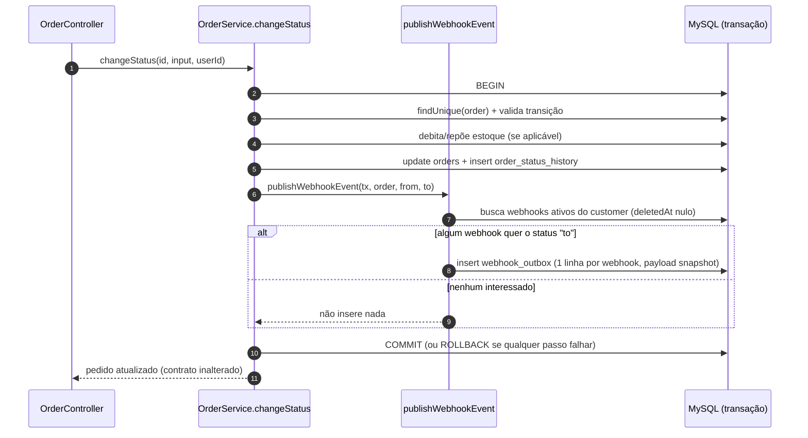
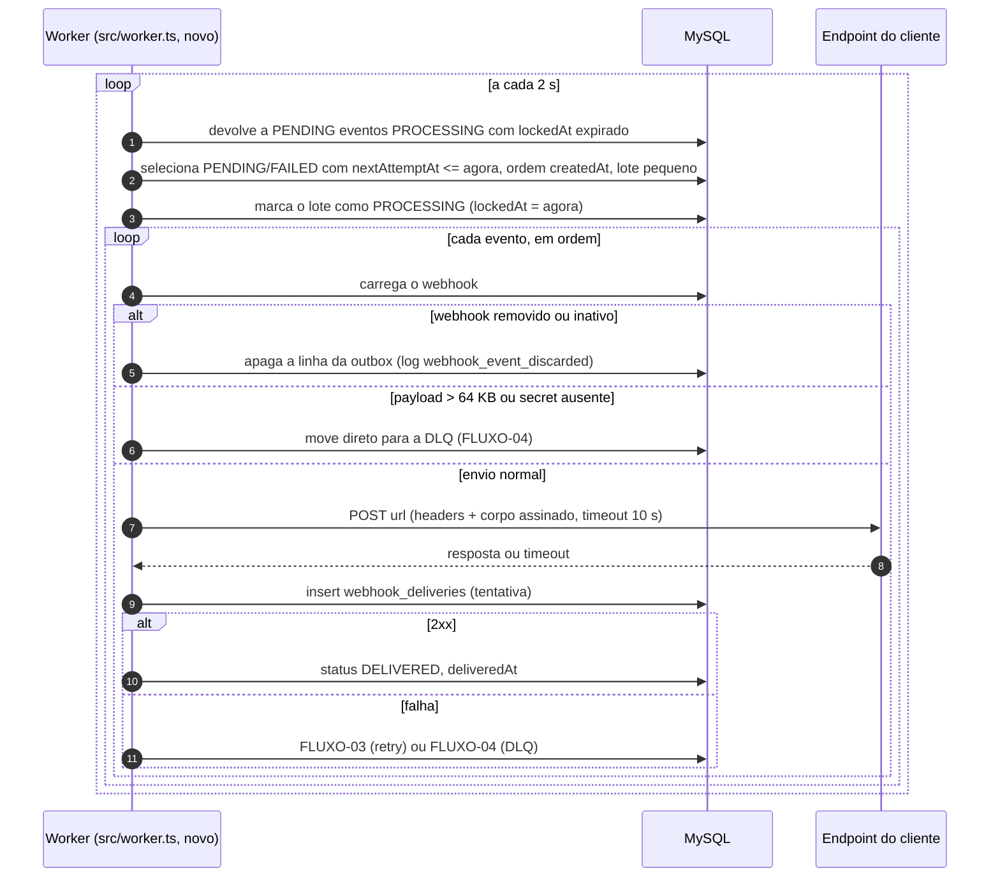
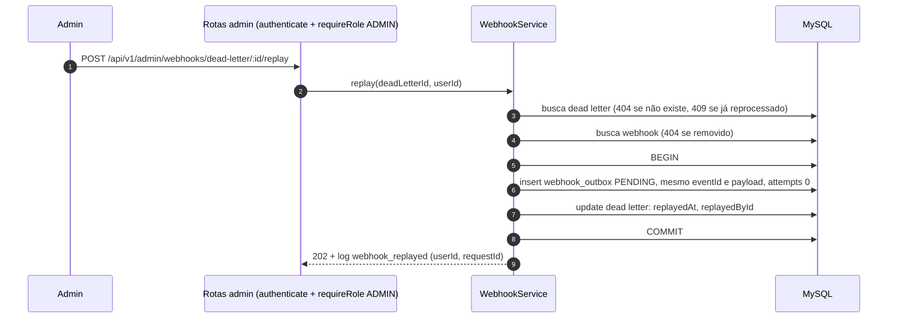

# FDD: Sistema de Webhooks de Notificação de Pedidos

| Campo | Valor |
|---|---|
| **Status** | Em revisão |
| **Data** | 2026-11-27 |
| **Documentos relacionados** | [PRD](./PRD.md) · [RFC](./RFC.md) · [ADRs](./adrs/README.md) |
| **Origem** | `TRANSCRICAO.md` (reunião técnica de quinta-feira, 09:00) e código do repositório |

**Convenções deste documento.** Cada afirmação traz sua origem: `[hh:mm] Nome` para a transcrição, caminho de arquivo para o código. Itens marcados **(proposta)** são escolhas de implementação deste FDD que a reunião não fechou; itens marcados **(interpretação)** são leituras de falas ambíguas, registradas também nos ADRs. Arquivos que ainda não existem aparecem como **(novo, a criar)**. Todas as rotas ficam sob o prefixo `/api/v1`, onde a aplicação monta o router (`src/app.ts`).

---

## 1. Contexto e motivação técnica

Clientes B2B fazem polling no `GET /orders` para descobrir mudanças de status ([09:00] Marcos) e querem ser avisados em menos de 10 segundos ([09:02] Marcos). O sistema não tem nenhum mecanismo de eventos, filas ou HTTP de saída. Toda mudança de status passa por `OrderService.changeStatus` (`src/modules/orders/order.service.ts`), dentro de uma transação Prisma que valida a máquina de estados, ajusta estoque, atualiza o pedido e grava `order_status_history`.

A arquitetura escolhida está no [RFC](./RFC.md) e nos ADRs: outbox na mesma transação ([ADR-001](./adrs/ADR-001-outbox-no-mysql.md)), worker separado com polling ([ADR-002](./adrs/ADR-002-worker-separado-com-polling.md)), retry e DLQ ([ADR-003](./adrs/ADR-003-retry-backoff-exponencial-e-dlq.md)), HMAC por endpoint ([ADR-004](./adrs/ADR-004-autenticacao-hmac-sha256-por-endpoint.md)), at-least-once ([ADR-005](./adrs/ADR-005-entrega-at-least-once-com-event-id.md)), reuso de padrões ([ADR-006](./adrs/ADR-006-reuso-dos-padroes-do-projeto.md)) e snapshot do payload ([ADR-007](./adrs/ADR-007-snapshot-do-payload-na-insercao.md)). Este documento especifica **como construir**.

## 2. Objetivos técnicos

| ID | Objetivo | Origem |
|---|---|---|
| FDD-OBJ-01 | Nenhuma mudança de status commitada sem o evento correspondente para os webhooks interessados; falha na outbox desfaz a mudança | [09:40] Bruno, [09:41] Diego |
| FDD-OBJ-02 | Latência entre o commit da mudança e a entrega abaixo de 10 s em operação normal; o polling contribui com até ~2 s | [09:02] Marcos, [09:09] Diego, [09:10] Larissa |
| FDD-OBJ-03 | Timeout de 10 s por chamada HTTP ao cliente | [09:42] Diego |
| FDD-OBJ-04 | Janela de retentativas de ~14 h 36 min antes da DLQ (1 envio + 5 retentativas) | [09:17] Diego, [09:17] Larissa; interpretação L-01 no [ADR-003](./adrs/ADR-003-retry-backoff-exponencial-e-dlq.md) |
| FDD-OBJ-05 | Payload de no máximo 64 KB | [09:24] Diego, [09:24] Larissa |
| FDD-OBJ-06 | Nenhuma dependência npm nova; reuso dos padrões do projeto | [09:29] Bruno, [09:30] Larissa |
| FDD-OBJ-07 | Nenhuma quebra nos contratos atuais da API | Decorrência de [09:40] Bruno (mudança interna ao `changeStatus`) |

## 3. Escopo e exclusões

**Incluído:**
- Cadastro, listagem, edição, remoção de webhooks, com filtro por status ([09:31] Marcos, [09:33] Bruno, [09:33] Marcos).
- Geração de secret na criação e rotação com 24 h de convivência ([09:31] Marcos, [09:21] Sofia).
- Gravação de eventos na outbox dentro do `changeStatus` ([09:40] Bruno).
- Worker de entrega com assinatura HMAC, timeout, retry, DLQ ([09:09], [09:15]–[09:18] Diego, [09:20] Sofia).
- Histórico das últimas 100 entregas por webhook ([09:34] Marcos).
- Replay manual da DLQ restrito a `ADMIN`, com auditoria ([09:18] Diego, [09:36] Sofia).

**Excluído desta fase:**

| Exclusão | Origem |
|---|---|
| Aviso por e-mail ao cliente quando o webhook falha | [09:37] Larissa |
| Dashboard visual para o cliente | [09:40] Larissa |
| Arquivamento de eventos entregues (~30 dias) | [09:08] Diego |
| Webhooks de entrada (cliente → plataforma) | [09:02] Marcos, [09:03] Sofia |
| Rate limiting de saída ("observar e decidir depois") | [09:39] Larissa — ver RFC-OQ-01 |
| Múltiplos workers em paralelo e ordering global | [09:12]–[09:13] Diego, [09:13] Larissa |
| Evento na **criação** do pedido (`null → PENDING`) — a criação usa `create()`, não `changeStatus` | `src/modules/orders/order.service.ts` (interpretação L-09) |
| Endpoint de listagem da DLQ — o id para replay vem do histórico de entregas (seção 6.6) | Não discutido na reunião (escolha D-5) |

## 4. Modelo de dados (proposta)

Quatro models novos no `prisma/schema.prisma`, seguindo as convenções existentes: id UUID `@db.Char(36)` ([09:51] Larissa), `createdAt`/`updatedAt`, tabelas em snake_case via `@@map` e índices explícitos. Os nomes `webhook_outbox` e `webhook_dead_letter` vêm da reunião ([09:06] Diego, [09:18] Diego); os demais e todos os tipos e tamanhos de coluna são **(proposta)**.

```prisma
enum WebhookOutboxStatus {
  PENDING     // aguardando primeiro envio ou replay
  PROCESSING  // reivindicado pelo worker
  FAILED      // falha transitória, aguardando retentativa (interpretação L-07)
  DELIVERED   // entregue com 2xx
}

model WebhookEndpoint {
  id                      String    @id @default(uuid()) @db.Char(36)
  customerId              String    @db.Char(36)
  url                     String    @db.VarChar(2048)
  events                  Json      // lista de OrderStatus que o webhook quer receber
  secret                  String    @db.VarChar(64)
  previousSecret          String?   @db.VarChar(64)
  previousSecretExpiresAt DateTime?
  active                  Boolean   @default(true)
  deletedAt               DateTime? // remoção lógica (escolha D-2)
  createdAt               DateTime  @default(now())
  updatedAt               DateTime  @updatedAt

  customer Customer @relation(fields: [customerId], references: [id])

  @@index([customerId])
  @@map("webhook_endpoints")
}

model WebhookOutbox {
  id                String              @id @default(uuid()) @db.Char(36)
  eventId           String              @unique @db.Char(36)  // enviado em X-Event-Id
  webhookEndpointId String              @db.Char(36)
  orderId           String              @db.Char(36)          // sem FK: o evento é um snapshot
  eventType         String              @db.VarChar(64)
  payload           Json                                       // snapshot (ADR-007)
  status            WebhookOutboxStatus @default(PENDING)
  attempts          Int                 @default(0)            // envios já realizados
  nextAttemptAt     DateTime            @default(now())
  lockedAt          DateTime?
  lastErrorCode     String?             @db.VarChar(64)
  deliveredAt       DateTime?
  createdAt         DateTime            @default(now())
  updatedAt         DateTime            @updatedAt

  @@index([status, nextAttemptAt])
  @@index([createdAt])
  @@map("webhook_outbox")
}

model WebhookDelivery {
  id                String   @id @default(uuid()) @db.Char(36)
  webhookEndpointId String   @db.Char(36)
  eventId           String   @db.Char(36)
  attempt           Int                   // 1 = envio inicial, 2..6 = retentativas
  success           Boolean
  requestPayload    Json
  responseStatus    Int?
  responseBody      String?  @db.Text     // truncado (tamanho configurável)
  durationMs        Int
  errorCode         String?  @db.VarChar(64)
  deadLetterId      String?  @db.Char(36) // preenchido quando a tentativa leva à DLQ
  createdAt         DateTime @default(now())

  @@index([webhookEndpointId, createdAt])
  @@index([eventId])
  @@map("webhook_deliveries")
}

model WebhookDeadLetter {
  id                String    @id @default(uuid()) @db.Char(36)
  eventId           String    @db.Char(36)
  webhookEndpointId String    @db.Char(36)
  orderId           String    @db.Char(36)
  eventType         String    @db.VarChar(64)
  payload           Json
  errorCode         String    @db.VarChar(64)
  failureReason     String    @db.VarChar(500)
  attempts          Int
  failedAt          DateTime  @default(now())
  replayedAt        DateTime?
  replayedById      String?   @db.Char(36)

  @@index([webhookEndpointId])
  @@index([eventId])
  @@map("webhook_dead_letter")
}
```

| ID | Decisão de modelagem | Origem |
|---|---|---|
| FDD-DADOS-01 | `webhook_endpoints` guarda url, secret, `customerId` e estado ativo | [09:21] Bruno, [09:21] Sofia |
| FDD-DADOS-02 | **Uma linha de outbox por webhook interessado**, cada uma com seu `eventId`; retry e DLQ independentes por endpoint | Escolha D-1 (proposta), apoiada em `X-Webhook-Id` por envio ([09:44] Sofia) |
| FDD-DADOS-03 | Índice por status e por data de criação na outbox | [09:08] Diego |
| FDD-DADOS-04 | Payload gravado como snapshot no momento da inserção | [09:52] Larissa; [ADR-007](./adrs/ADR-007-snapshot-do-payload-na-insercao.md) |
| FDD-DADOS-05 | `webhook_dead_letter` com payload, motivo da falha e timestamp; campos de replay para auditoria | [09:18] Diego, [09:36] Sofia |
| FDD-DADOS-06 | `webhook_deliveries` registra cada tentativa (resultado, payload, resposta, tempo) para o histórico | [09:34] Marcos; tabela proposta (L-08) |
| FDD-DADOS-07 | `DELETE` é lógico (`deletedAt`), preservando histórico e DLQ | Escolha D-2 (proposta) |
| FDD-DADOS-08 | `orderId` na outbox e na DLQ sem FK: pedidos `PENDING`/`CANCELLED` podem ser apagados (`OrderService.delete`) e o evento precisa sobreviver | `src/modules/orders/order.service.ts` (proposta) |

`Customer` ganha só a relação inversa do Prisma (`webhookEndpoints WebhookEndpoint[]`), sem coluna nova em `customers`. A migração é aditiva (seção 10).

## 5. Fluxos detalhados

### FDD-FLUXO-01 — Criação do evento na outbox (dentro do `changeStatus`)



1. `changeStatus` executa as etapas atuais sem mudança (`src/modules/orders/order.service.ts`, transação aberta em `this.prisma.$transaction`).
2. Logo após `tx.orderStatusHistory.create(...)`, chama `publishWebhookEvent(tx, order, from, to)` ([09:41] Bruno), definida em `src/modules/webhooks/webhook.publisher.ts` **(novo, a criar)**.
3. A função lê os `WebhookEndpoint` do `order.customerId` com `active = true` e `deletedAt = null` e mantém só os que têm `to` em `events` — **filtro na inserção**: sem interessados, nada é gravado ([09:34] Bruno, [09:34] Diego).
4. Para cada interessado, gera `eventId` (UUID, [09:25] Diego), monta o payload (seção 6.8) com o `timestamp` do momento da mudança e grava uma linha `PENDING` com `nextAttemptAt = agora`.
5. Qualquer exceção propaga e a transação inteira faz rollback ([09:40] Bruno). Validações que falham antes (mesmo status, transição inválida, estoque insuficiente) acontecem antes do passo 2: nenhum evento é gerado.

### FDD-FLUXO-02 — Processamento pelo worker



1. **Intervalo:** a cada 2 s ([09:09] Diego). O processo é `src/worker.ts` **(novo, a criar)**, com `PrismaClient` próprio ([09:30] Bruno) e a lógica em `src/modules/webhooks/webhook.processor.ts` **(novo, a criar)** ([09:28] Bruno).
2. **Recuperação de órfãos (interpretação L-06):** eventos em `PROCESSING` com `lockedAt` mais antigo que o limite configurado voltam para `PENDING`. O limite deve ser maior que `timeout (10 s) × tamanho do lote`.
3. **Reivindicação:** seleciona `status IN (PENDING, FAILED) AND nextAttemptAt <= agora ORDER BY createdAt LIMIT <lote>` ([09:08] Diego: "batch pequeno") e marca como `PROCESSING` com update condicional ao status anterior.
4. **Envio sequencial em ordem de `createdAt`**, o que preserva a ordem por pedido com single-worker ([09:12] Diego). Com retentativas, a ordem pode ser quebrada (RFC-OQ-04); **até a decisão, o comportamento padrão é não segurar eventos posteriores**.
5. **Webhook removido ou inativo:** o evento é descartado (linha apagada da outbox) e registrado em log (escolha D-2, L-12).
6. **Pré-validações sem retry:** corpo serializado acima de 64 KB → DLQ com `WEBHOOK_PAYLOAD_TOO_LARGE` ([09:24] Larissa, interpretação L-02); webhook sem secret → DLQ com `WEBHOOK_SECRET_REQUIRED`.
7. **Envio:** `fetch` nativo com `AbortSignal.timeout(10_000)` ([09:42] Diego), headers e assinatura da seção 6.8. A URL é lida do webhook **no momento do envio** (uma URL corrigida via `PATCH` vale para retentativas pendentes).
8. **Registro:** toda tentativa gera uma linha em `webhook_deliveries` (resultado, payload, status e corpo da resposta, duração).
9. **Resultado:** 2xx → `DELIVERED`. Qualquer outro status, erro de rede ou timeout → FLUXO-03 (interpretação L-05).

### FDD-FLUXO-03 — Retry com backoff

Após o envio número *n* falhar (`attempts = n`):

| Envio que falhou (*n*) | Próxima ação | `nextAttemptAt` |
|---|---|---|
| 1 (inicial) | Retentativa 1 | agora + 1 min |
| 2 | Retentativa 2 | agora + 5 min |
| 3 | Retentativa 3 | agora + 30 min |
| 4 | Retentativa 4 | agora + 2 h |
| 5 | Retentativa 5 | agora + 12 h |
| 6 | **DLQ** (FLUXO-04), `WEBHOOK_MAX_ATTEMPTS_EXCEEDED` | — |

Intervalos de [09:17] Diego / [09:17] Larissa; contagem pela interpretação L-01 ([ADR-003](./adrs/ADR-003-retry-backoff-exponencial-e-dlq.md)). O evento fica com `status = FAILED`, `lastErrorCode` preenchido e `lockedAt = null`. Os intervalos ficam em constante no código (`src/modules/webhooks/webhook.constants.ts`, **novo, a criar**), não em variável de ambiente, porque são decisão de produto.

### FDD-FLUXO-04 — Movimentação para a DLQ

Em uma transação: (1) insere `webhook_dead_letter` com `eventId`, payload, `errorCode`, `failureReason`, `attempts` e `failedAt` ([09:18] Diego); (2) preenche `deadLetterId` na última linha de `webhook_deliveries` do evento; (3) apaga a linha da outbox — a falha permanente sai da outbox (interpretação L-07). Log `webhook_moved_to_dlq`.

### FDD-FLUXO-05 — Replay manual da DLQ



O evento volta à outbox como pendente ([09:18] Diego), **com o mesmo `eventId`** para preservar a deduplicação do cliente (interpretação do [ADR-005](./adrs/ADR-005-entrega-at-least-once-com-event-id.md)) e com o contador zerado (novo ciclo de 1 + 5). Só `ADMIN` ([09:36] Sofia), com o `requireRole` existente ([09:36] Larissa); o log registra quem fez ([09:36] Sofia).

### FDD-FLUXO-06 — Rotação de secret

1. `POST /api/v1/webhooks/:id/rotate-secret` (caminho **proposta**, L-04).
2. Se já há uma rotação em andamento (`previousSecretExpiresAt > agora`) → `409 WEBHOOK_SECRET_ROTATION_IN_PROGRESS` **(proposta)**, para nunca existirem três secrets válidas.
3. Senão: `previousSecret = secret`, `previousSecretExpiresAt = agora + 24 h`, `secret = nova` ([09:21] Sofia). A nova secret é devolvida uma única vez.
4. Durante a janela, o worker envia **duas assinaturas** (seção 6.8); depois dela, só a nova (proposta L-03, sujeita a RFC-OQ-05).

Geração de secret **(proposta)**: `crypto.randomBytes(32).toString('hex')` (64 caracteres), módulo nativo do Node ≥ 20 (`package.json`, `engines`). Revisão obrigatória pela Sofia ([09:46] Sofia).

## 6. Contratos públicos

Todas as rotas exigem `Authorization: Bearer <jwt>` (`authenticate`, `src/middlewares/auth.middleware.ts`). O CRUD aceita qualquer role autenticada ([09:37] Sofia); o replay exige `ADMIN` ([09:36] Sofia). O `customerId` **não vem do JWT**: vai no body ou na query ([09:32] Larissa), porque o token é do usuário operador ([09:32] Bruno). Erros seguem o envelope do `errorMiddleware` (`src/middlewares/error.middleware.ts`):

```json
{ "error": { "code": "WEBHOOK_NOT_FOUND", "message": "Webhook not found" } }
```

Respostas de recurso único devolvem o objeto direto (como `OrderController`, `src/modules/orders/order.controller.ts`); listagens usam `{ data, pagination }` (`src/shared/http/response.ts`). **A secret nunca aparece em respostas, exceto na criação e na rotação.**

### 6.1 FDD-CONTRATO-01 — `POST /api/v1/webhooks` · criar webhook

Origem: [09:31] Marcos (url, lista de status, secret gerada e devolvida), [09:32] Larissa (customerId no body).

Request:
```http
POST /api/v1/webhooks
Authorization: Bearer <jwt>
Content-Type: application/json

{
  "customerId": "3f6c1d2e-8a4b-4c1e-9f0a-2b7d5e6c8a91",
  "url": "https://webhooks.cliente.example/pedidos",
  "events": ["SHIPPED", "DELIVERED"]
}
```

Response `201 Created`:
```json
{
  "id": "b2a7e0c4-5d3f-4e8a-a1b9-0c6d7e8f9a12",
  "customerId": "3f6c1d2e-8a4b-4c1e-9f0a-2b7d5e6c8a91",
  "url": "https://webhooks.cliente.example/pedidos",
  "events": ["SHIPPED", "DELIVERED"],
  "active": true,
  "secret": "4f9c2e7a1b8d3f6e0a5c9b2d7e1f4a8c3b6d9e2f5a8c1b4d7e0f3a6c9b2e5d8f",
  "createdAt": "2026-11-27T13:00:00.000Z",
  "updatedAt": "2026-11-27T13:00:00.000Z"
}
```

| Status | Quando |
|---|---|
| 201 | Criado; `secret` devolvida apenas nesta resposta |
| 400 `VALIDATION_ERROR` | Body fora do schema (campo ausente, `customerId` não-UUID) |
| 400 `WEBHOOK_INVALID_URL` | URL malformada ou não-`https` ([09:23] Sofia) |
| 400 `WEBHOOK_INVALID_EVENTS` | `events` vazio ou com status não emitível (ex.: `PENDING`) |
| 401 `UNAUTHORIZED` | Sem token ou token inválido |
| 404 `NOT_FOUND` | `customerId` inexistente (reusa `NotFoundError('Customer')`) |

**Semântica:** valores aceitos em `events`: `PAID`, `PROCESSING`, `SHIPPED`, `DELIVERED`, `CANCELLED` — os destinos possíveis de transição em `src/modules/orders/order.status.ts` (escolha D-6). A validação de `https` usa um schema Zod ([09:23] Sofia) aplicado **no service**, para que a falha vire `WEBHOOK_INVALID_URL` e não o `VALIDATION_ERROR` genérico do `validate.middleware` (escolha D-3).

### 6.2 FDD-CONTRATO-02 — `GET /api/v1/webhooks` · listar webhooks de um customer

Origem: [09:33] Bruno ("GET pra listar os webhooks de um customer").

Request:
```http
GET /api/v1/webhooks?customerId=3f6c1d2e-8a4b-4c1e-9f0a-2b7d5e6c8a91&page=1&pageSize=20
Authorization: Bearer <jwt>
```

Response `200 OK`:
```json
{
  "data": [
    {
      "id": "b2a7e0c4-5d3f-4e8a-a1b9-0c6d7e8f9a12",
      "customerId": "3f6c1d2e-8a4b-4c1e-9f0a-2b7d5e6c8a91",
      "url": "https://webhooks.cliente.example/pedidos",
      "events": ["SHIPPED", "DELIVERED"],
      "active": true,
      "createdAt": "2026-11-27T13:00:00.000Z",
      "updatedAt": "2026-11-27T13:00:00.000Z"
    }
  ],
  "pagination": { "page": 1, "pageSize": 20, "total": 1, "totalPages": 1 }
}
```

| Status | Quando |
|---|---|
| 200 | Lista (sem `secret`, sem removidos) |
| 400 `VALIDATION_ERROR` | `customerId` ausente ou não-UUID; `page`/`pageSize` inválidos (mesmo padrão de `src/modules/orders/order.schemas.ts`) |
| 401 `UNAUTHORIZED` | Sem token ou token inválido |

### 6.3 FDD-CONTRATO-03 — `PATCH /api/v1/webhooks/:id` · editar webhook

Origem: [09:33] Bruno ("PATCH pra editar"); estado ativo de [09:21] Bruno.

Request:
```http
PATCH /api/v1/webhooks/b2a7e0c4-5d3f-4e8a-a1b9-0c6d7e8f9a12
Authorization: Bearer <jwt>
Content-Type: application/json

{ "events": ["PROCESSING", "SHIPPED", "DELIVERED"], "active": true }
```

Response `200 OK` (sem `secret`):
```json
{
  "id": "b2a7e0c4-5d3f-4e8a-a1b9-0c6d7e8f9a12",
  "customerId": "3f6c1d2e-8a4b-4c1e-9f0a-2b7d5e6c8a91",
  "url": "https://webhooks.cliente.example/pedidos",
  "events": ["PROCESSING", "SHIPPED", "DELIVERED"],
  "active": true,
  "createdAt": "2026-11-27T13:00:00.000Z",
  "updatedAt": "2026-11-27T13:20:00.000Z"
}
```

| Status | Quando |
|---|---|
| 200 | Atualizado |
| 400 `VALIDATION_ERROR` | Body vazio ou com campo desconhecido; `id` não-UUID |
| 400 `WEBHOOK_INVALID_URL` | Nova URL inválida ou não-`https` |
| 400 `WEBHOOK_INVALID_EVENTS` | Nova lista vazia ou com status não emitível |
| 401 `UNAUTHORIZED` | Sem token |
| 404 `WEBHOOK_NOT_FOUND` | Inexistente ou removido |

**Semântica:** campos editáveis: `url`, `events`, `active`. `customerId` e `secret` não são editáveis (secret só por rotação). Mudança de `events` vale para eventos futuros; eventos já na outbox seguem para o webhook. `active: false` faz o worker descartar os pendentes.

### 6.4 FDD-CONTRATO-04 — `DELETE /api/v1/webhooks/:id` · remover webhook

Origem: [09:33] Bruno ("DELETE pra remover").

```http
DELETE /api/v1/webhooks/b2a7e0c4-5d3f-4e8a-a1b9-0c6d7e8f9a12
Authorization: Bearer <jwt>
```

Response `204 No Content` (sem corpo).

| Status | Quando |
|---|---|
| 204 | Removido (lógico, `deletedAt`) |
| 401 `UNAUTHORIZED` | Sem token |
| 404 `WEBHOOK_NOT_FOUND` | Inexistente ou já removido |

**Semântica:** remoção lógica (escolha D-2). Eventos pendentes do webhook são descartados pelo worker; histórico e DLQ ficam preservados no banco.

### 6.5 FDD-CONTRATO-05 — `POST /api/v1/webhooks/:id/rotate-secret` · rotacionar secret (caminho proposto)

Origem: [09:21] Sofia (rotação pela API, 24 h de convivência); caminho é proposta (L-04).

```http
POST /api/v1/webhooks/b2a7e0c4-5d3f-4e8a-a1b9-0c6d7e8f9a12/rotate-secret
Authorization: Bearer <jwt>
```

Response `200 OK`:
```json
{
  "id": "b2a7e0c4-5d3f-4e8a-a1b9-0c6d7e8f9a12",
  "secret": "9a1c4e7b2d5f8a0c3e6b9d2f5a8c1e4b7d0f3a6c9e2b5d8f1a4c7e0b3d6f9a2c",
  "previousSecretExpiresAt": "2026-11-28T13:10:00.000Z"
}
```

| Status | Quando |
|---|---|
| 200 | Nova secret gerada; a anterior vale até `previousSecretExpiresAt` |
| 401 `UNAUTHORIZED` | Sem token |
| 404 `WEBHOOK_NOT_FOUND` | Inexistente ou removido |
| 409 `WEBHOOK_SECRET_ROTATION_IN_PROGRESS` | Já existe secret anterior dentro da janela de 24 h (proposta) |

### 6.6 FDD-CONTRATO-06 — `GET /api/v1/webhooks/:id/deliveries` · histórico de entregas

Origem: [09:34] Marcos ("últimos 100 webhooks… sucesso/falha, payload, response, tempo de resposta").

```http
GET /api/v1/webhooks/b2a7e0c4-5d3f-4e8a-a1b9-0c6d7e8f9a12/deliveries
Authorization: Bearer <jwt>
```

Response `200 OK`:
```json
{
  "data": [
    {
      "id": "e1d2c3b4-a5f6-4789-8a0b-1c2d3e4f5a6b",
      "eventId": "7c9e6679-7425-40de-944b-e07fc1f90ae7",
      "attempt": 6,
      "success": false,
      "responseStatus": 503,
      "responseBody": "Service Unavailable",
      "durationMs": 184,
      "errorCode": "WEBHOOK_DELIVERY_FAILED",
      "deadLetterId": "0a1b2c3d-4e5f-4a6b-8c7d-9e0f1a2b3c4d",
      "payload": { "event_id": "7c9e6679-7425-40de-944b-e07fc1f90ae7", "event_type": "order.status_changed", "...": "..." },
      "createdAt": "2026-11-28T03:36:10.000Z"
    }
  ]
}
```

| Status | Quando |
|---|---|
| 200 | Até 100 tentativas mais recentes, da mais nova para a mais antiga |
| 400 `VALIDATION_ERROR` | `id` não-UUID |
| 401 `UNAUTHORIZED` | Sem token |
| 404 `WEBHOOK_NOT_FOUND` | Inexistente ou removido |

**Semântica:** cada item é uma tentativa. `deadLetterId` aparece quando a tentativa levou o evento à DLQ — é como o administrador obtém o id para o replay (escolha D-5). Sem paginação: o limite fixo de 100 vem da reunião.

### 6.7 FDD-CONTRATO-07 — `POST /api/v1/admin/webhooks/dead-letter/:id/replay` · reprocessar DLQ

Origem: [09:18] Diego (endpoint e semântica), [09:36] Sofia (`ADMIN` e log de auditoria), [09:36] Larissa (`requireRole`).

```http
POST /api/v1/admin/webhooks/dead-letter/0a1b2c3d-4e5f-4a6b-8c7d-9e0f1a2b3c4d/replay
Authorization: Bearer <jwt de ADMIN>
```

Response `202 Accepted`:
```json
{
  "deadLetterId": "0a1b2c3d-4e5f-4a6b-8c7d-9e0f1a2b3c4d",
  "eventId": "7c9e6679-7425-40de-944b-e07fc1f90ae7",
  "outboxId": "5b6c7d8e-9f0a-4b1c-8d2e-3f4a5b6c7d8e",
  "status": "PENDING"
}
```

| Status | Quando |
|---|---|
| 202 | Evento recolocado na outbox; será enviado no próximo ciclo |
| 400 `VALIDATION_ERROR` | `id` não-UUID |
| 401 `UNAUTHORIZED` | Sem token |
| 403 `FORBIDDEN` | Role diferente de `ADMIN` (`requireRole`, `src/middlewares/auth.middleware.ts`) |
| 404 `WEBHOOK_DEAD_LETTER_NOT_FOUND` | Dead letter inexistente |
| 404 `WEBHOOK_NOT_FOUND` | Webhook do evento foi removido |
| 409 `WEBHOOK_DEAD_LETTER_ALREADY_REPLAYED` | Já reprocessado (proposta, evita duplicar o envio) |

**Semântica:** `202` porque a entrega é assíncrona. Mesmo `eventId` do original. Log `webhook_replayed` com `deadLetterId`, `eventId`, `userId` e `requestId`.

### 6.8 FDD-CONTRATO-08 — Requisição enviada ao cliente (webhook de saída)

Origem: payload de [09:43] Diego e [09:44] Bruno; headers de [09:44] Diego, [09:44] Sofia e [09:45] Diego; assinatura de [09:20] e [09:22] Sofia.

```http
POST https://webhooks.cliente.example/pedidos
Content-Type: application/json
X-Event-Id: 7c9e6679-7425-40de-944b-e07fc1f90ae7
X-Webhook-Id: b2a7e0c4-5d3f-4e8a-a1b9-0c6d7e8f9a12
X-Timestamp: 2026-11-27T13:45:14.002Z
X-Signature: sha256=5d41402abc4b2a76b9719d911017c592b6e3f1c8a7d9e0f2a4b6c8d0e2f4a6b8

{
  "event_id": "7c9e6679-7425-40de-944b-e07fc1f90ae7",
  "event_type": "order.status_changed",
  "timestamp": "2026-11-27T13:45:12.345Z",
  "order_id": "9d8c7b6a-5f4e-4d3c-8b2a-1f0e9d8c7b6a",
  "order_number": "ORD-000123",
  "from_status": "PROCESSING",
  "to_status": "SHIPPED",
  "customer_id": "3f6c1d2e-8a4b-4c1e-9f0a-2b7d5e6c8a91",
  "total_cents": 15900
}
```

| Elemento | Especificação | Origem |
|---|---|---|
| `event_id` / `X-Event-Id` | UUID gerado na inserção na outbox; único por evento; chave de deduplicação | [09:25] Diego |
| `event_type` | `order.status_changed` | [09:43] Diego |
| `timestamp` | ISO 8601, momento da mudança de status | [09:43] Diego |
| `order_id`, `order_number`, `from_status`, `to_status`, `customer_id`, `total_cents` | Campos do pedido; **sem itens** — detalhes via `GET /api/v1/orders/:id` | [09:43] Diego, [09:44] Bruno; formato `ORD-NNNNNN` de `src/modules/orders/order.service.ts` |
| `X-Webhook-Id` | Id do `WebhookEndpoint` que originou o envio | [09:44] Sofia, [09:45] Diego |
| `X-Timestamp` | Momento do envio, ISO 8601 (formato é proposta) | [09:44] Diego |
| `X-Signature` | `sha256=<hex>` = HMAC-SHA256(secret, corpo bruto). Durante a janela de rotação: `sha256=<hex nova>,sha256=<hex antiga>` | [09:20] Sofia, [09:22] Sofia; formato D-4 (proposta) |
| `Content-Type` | `application/json` | [09:44] Diego |

**Semântica para o cliente:**
- Sucesso = qualquer `2xx` em até 10 s ([09:42] Diego; interpretação L-05). Qualquer outra resposta, erro de rede ou timeout gera retentativa.
- Entrega **at-least-once**: deduplicar por `X-Event-Id` ([09:24]–[09:25] Diego).
- Verificação: recalcular o HMAC-SHA256 sobre o **corpo bruto recebido** e comparar em tempo constante com **qualquer** um dos valores de `X-Signature`.

```ts
// Exemplo de verificação no cliente (Node.js)
import { createHmac, timingSafeEqual } from 'node:crypto';

function isValidSignature(rawBody: Buffer, header: string, secret: string): boolean {
  const expected = createHmac('sha256', secret).update(rawBody).digest('hex');
  return header.split(',').some((part) => {
    const received = part.trim().replace(/^sha256=/, '');
    return received.length === expected.length &&
      timingSafeEqual(Buffer.from(received), Buffer.from(expected));
  });
}
```

O conteúdo assinado é **apenas o corpo** ([09:22] Sofia); `X-Timestamp` não entra na assinatura (ver FDD-RISK-03).

## 7. Matriz de erros

### 7.1 Erros devolvidos pela API

Classes em `src/modules/webhooks/webhook.errors.ts` **(novo, a criar)**, derivadas das existentes em `src/shared/errors/http-errors.ts` e `src/shared/errors/app-error.ts` ([09:28] Bruno, [09:29] Larissa).

| ID | Código | HTTP | Classe proposta | Quando | Origem |
|---|---|---|---|---|---|
| FDD-ERR-01 | `WEBHOOK_NOT_FOUND` | 404 | `WebhookNotFoundError extends AppError` (o `NotFoundError` atual fixa o código `NOT_FOUND`) | Webhook inexistente ou removido | [09:28] Bruno |
| FDD-ERR-02 | `WEBHOOK_INVALID_URL` | 400 | `WebhookInvalidUrlError extends BadRequestError` | URL malformada ou não-`https` | [09:28] Bruno, [09:23] Sofia |
| FDD-ERR-03 | `WEBHOOK_INVALID_EVENTS` | 400 | `WebhookInvalidEventsError extends BadRequestError` | `events` vazio ou com status não emitível | Proposta (derivada de [09:33] Marcos e `src/modules/orders/order.status.ts`) |
| FDD-ERR-04 | `WEBHOOK_SECRET_ROTATION_IN_PROGRESS` | 409 | `extends ConflictError` | Rotação pedida dentro da janela de 24 h | Proposta (derivada de [09:21] Sofia) |
| FDD-ERR-05 | `WEBHOOK_DEAD_LETTER_NOT_FOUND` | 404 | `extends AppError` | Replay de dead letter inexistente | Proposta (derivada de [09:18] Diego) |
| FDD-ERR-06 | `WEBHOOK_DEAD_LETTER_ALREADY_REPLAYED` | 409 | `extends ConflictError` | Replay repetido | Proposta |

Erros existentes **reaproveitados sem código novo** ([ADR-006](./adrs/ADR-006-reuso-dos-padroes-do-projeto.md)): `VALIDATION_ERROR` (shape do body/query/params), `UNAUTHORIZED` e `FORBIDDEN` (`src/middlewares/auth.middleware.ts`), `NOT_FOUND` para customer inexistente. O `errorMiddleware` trata todos sem alteração ([09:29] Bruno).

### 7.2 Erros internos do worker

Nunca viram resposta HTTP; são gravados em `webhook_deliveries.errorCode`, `webhook_outbox.lastErrorCode` e `webhook_dead_letter.errorCode`, e aparecem nos logs.

| ID | Código | Quando | Tratamento | Origem |
|---|---|---|---|---|
| FDD-ERR-07 | `WEBHOOK_DELIVERY_TIMEOUT` | Sem resposta em 10 s | Retry (FLUXO-03) | [09:42] Diego |
| FDD-ERR-08 | `WEBHOOK_DELIVERY_FAILED` | Status não-2xx ou erro de rede/TLS | Retry (FLUXO-03) | Interpretação L-05 |
| FDD-ERR-09 | `WEBHOOK_MAX_ATTEMPTS_EXCEEDED` | 6º envio falhou | DLQ (FLUXO-04) | [09:15] Diego, [09:17] Larissa; código proposto |
| FDD-ERR-10 | `WEBHOOK_PAYLOAD_TOO_LARGE` | Corpo > 64 KB | DLQ direto, sem envio | [09:23] Sofia, [09:24] Larissa; interpretação L-02 |
| FDD-ERR-11 | `WEBHOOK_SECRET_REQUIRED` | Webhook sem secret no momento de assinar | DLQ direto, sem envio | [09:28] Bruno (código); uso é interpretação |

## 8. Estratégias de resiliência

| ID | Estratégia | Especificação | Origem |
|---|---|---|---|
| FDD-RES-01 | Timeout | `AbortSignal.timeout(10_000)` em cada `fetch` | [09:42] Diego |
| FDD-RES-02 | Retry com backoff | 1 envio + 5 retentativas: 1m, 5m, 30m, 2h, 12h (tabela do FLUXO-03) | [09:17] Diego, [09:17] Larissa; L-01 |
| FDD-RES-03 | Critério de sucesso | 2xx = sucesso; qualquer outro resultado = falha com retry | Interpretação L-05 |
| FDD-RES-04 | Falhas não retentáveis | Payload > 64 KB e secret ausente vão direto para a DLQ | [09:24] Larissa; L-02 |
| FDD-RES-05 | DLQ + replay | Tabela separada; replay manual por `ADMIN` | [09:18] Diego, [09:36] Sofia |
| FDD-RES-06 | Recuperação de órfãos | `PROCESSING` com `lockedAt` expirado volta a `PENDING` a cada ciclo; limite configurável > `10 s × lote` | Interpretação L-06 |
| FDD-RES-07 | Isolamento por endpoint | Uma linha por webhook (D-1): retry de um endpoint não bloqueia outro | Escolha D-1 |
| FDD-RES-08 | Isolamento da API | Lentidão ou queda do cliente não afeta a API; se o worker parar, eventos ficam seguros na outbox | [09:04] Bruno, [09:11] Diego |
| FDD-RES-09 | Desligamento gracioso | Em `SIGINT`/`SIGTERM`: para de reivindicar, termina o evento em curso, `prisma.$disconnect()` — mesmo padrão de `src/server.ts` | `src/server.ts` |
| FDD-RES-10 | Falha do banco no worker | Erro no ciclo é logado e o worker tenta no ciclo seguinte, sem encerrar o processo (proposta) | Proposta |
| FDD-RES-11 | Crash entre envio e registro | O evento volta por FDD-RES-06 e é reenviado; coberto pela deduplicação por `X-Event-Id` | [ADR-005](./adrs/ADR-005-entrega-at-least-once-com-event-id.md) |
| FDD-RES-12 | Fallback ao cliente | Não há canal alternativo nesta fase (e-mail adiado); o fallback é DLQ + replay | [09:37] Larissa |

**Configuração (proposta)**, em `src/config/env.ts` com default:

| Variável | Default | Origem do valor |
|---|---|---|
| `WEBHOOK_POLL_INTERVAL_MS` | `2000` | [09:09] Diego |
| `WEBHOOK_HTTP_TIMEOUT_MS` | `10000` | [09:42] Diego |
| `WEBHOOK_MAX_PAYLOAD_BYTES` | `65536` | [09:24] Diego |
| `WEBHOOK_BATCH_SIZE` | a definir na implementação ("batch pequeno") | [09:08] Diego |
| `WEBHOOK_PROCESSING_RECLAIM_MS` | a definir; deve ser > `HTTP_TIMEOUT × BATCH_SIZE` | Interpretação L-06 |

## 9. Observabilidade

O projeto tem logs estruturados com Pino (`src/shared/logger/index.ts`) e um `requestId` por requisição (`src/middlewares/request-logger.middleware.ts`), mas **não tem biblioteca de métricas nem de tracing**. Seguindo o reuso decidido ([09:29] Bruno, [09:30] Larissa), métricas e tracing abaixo são **propostas sem dependência nova**.

### 9.1 Logs

| ID | Evento de log (snake_case, como `server_started`) | Processo | Campos |
|---|---|---|---|
| FDD-OBS-01 | `worker_started` / `worker_stopped` | Worker | `pollIntervalMs`, `batchSize` |
| FDD-OBS-02 | `webhook_delivery_succeeded` | Worker | `eventId`, `webhookId`, `orderId`, `attempt`, `statusCode`, `durationMs` |
| FDD-OBS-03 | `webhook_delivery_failed` (nível `warn`) | Worker | idem + `errorCode`, `nextAttemptAt` |
| FDD-OBS-04 | `webhook_moved_to_dlq` (nível `error`) | Worker | `eventId`, `webhookId`, `deadLetterId`, `errorCode`, `attempts` |
| FDD-OBS-05 | `webhook_event_discarded` / `webhook_events_reclaimed` | Worker | `eventId` / quantidade |
| FDD-OBS-06 | `webhook_replayed` | API | `deadLetterId`, `eventId`, `userId`, `requestId` — auditoria ([09:36] Sofia) |
| FDD-OBS-07 | `webhook_secret_rotated` | API | `webhookId`, `userId`, `previousSecretExpiresAt` (nunca a secret) |

**Proteção de dados:** estender o `redact` de `src/shared/logger/index.ts` com `*.secret`, `*.previousSecret` e o header `x-signature`, para não repetir o vazamento de secret em log citado em [09:22] Diego. O logger do worker usa `service: 'order-management-worker'` no `base` (hoje fixo em `order-management-api`) — **proposta** de parametrizar `createLogger`.

### 9.2 Métricas (proposta)

Calculadas pelo worker a cada N ciclos, por consulta às tabelas, e emitidas como uma linha de log `webhook_worker_stats`:

| ID | Métrica | Para que serve |
|---|---|---|
| FDD-OBS-08 | Eventos pendentes (`PENDING` + `FAILED`) | Tamanho da fila |
| FDD-OBS-09 | Idade do evento pendente mais antigo | Alerta de worker parado ou atrasado |
| FDD-OBS-10 | Latência commit → entrega (`deliveredAt − createdAt`), média e p95 | Verificar a meta de < 10 s ([09:02] Marcos) |
| FDD-OBS-11 | Taxa de sucesso por webhook | Identificar cliente com problema |
| FDD-OBS-12 | Dead letters criadas no período e total pendente de replay | Acompanhamento da DLQ (RFC-RISK-06) |
| FDD-OBS-13 | Tempo de resposta dos clientes (`durationMs`) | Já exposto por webhook no histórico ([09:34] Marcos) |

Limiares de alerta não foram definidos na reunião; a única meta numérica é a latência < 10 s ([09:02] Marcos).

### 9.3 Tracing (proposta)

Sem biblioteca de tracing, a correlação ponta a ponta usa identificadores já presentes:

1. A requisição `PATCH /api/v1/orders/:id/status` é logada com `requestId` e `path` (contém o `orderId`) pelo `requestLogger`.
2. Cada evento gravado carrega `orderId` e `eventId`; todos os logs do worker trazem ambos.
3. O cliente recebe `X-Event-Id` e `X-Webhook-Id`; ao abrir chamado, informa o `eventId`, que leva ao histórico (`webhook_deliveries`), à DLQ e aos logs.

Propagar o `requestId` até a outbox exigiria levá-lo ao `OrderService` (hoje ele não recebe o request); fica como evolução, assim como adotar OpenTelemetry.

## 10. Dependências e compatibilidade

| Item | Situação |
|---|---|
| Dependências npm | **Nenhuma nova.** `fetch`, `AbortSignal.timeout` e `crypto` (HMAC, `randomBytes`, `timingSafeEqual`) são nativos do Node ≥ 20 (`package.json`, `engines`); `uuid`, `zod`, `pino` e `@prisma/client` já estão em `package.json` |
| Banco | MySQL 8 (`docker-compose.yml`) com suporte a `JSON`; migração **aditiva** (4 tabelas + 1 enum); nenhuma coluna alterada nas tabelas existentes |
| API existente | Contratos inalterados; `PATCH /api/v1/orders/:id/status` mantém request e response |
| Ordem de deploy | (1) migração → (2) API (passa a gravar eventos) → (3) worker. Eventos gravados antes do worker subir ficam na outbox e são enviados quando ele iniciar |
| Configuração | Novas variáveis opcionais com default (seção 8); o worker usa o mesmo `.env` e a mesma `DATABASE_URL` ([09:30] Bruno) |
| Lado do cliente | Endpoint `https`, resposta 2xx em até 10 s, verificação de HMAC, deduplicação por `X-Event-Id`; documentado no portal do desenvolvedor ([09:26] Marcos, [09:40] Marcos) |
| Revisão de segurança | Pelo menos dois dias úteis antes do deploy, focada em HMAC e geração de secret ([09:46] Sofia) |

## 11. Integração com o sistema existente

| ID | Arquivo (existente) | Como o módulo de webhooks se integra |
|---|---|---|
| FDD-INT-01 | `src/modules/orders/order.service.ts` | **Única alteração no fluxo de pedidos:** `import { publishWebhookEvent }` e uma chamada `await publishWebhookEvent(tx, order, from, to)` dentro do callback de `this.prisma.$transaction` do `changeStatus`, logo após `tx.orderStatusHistory.create(...)` e antes do `findUnique` de retorno. Usa o tipo `TxClient` já declarado no arquivo. O construtor de `OrderService` não muda ([09:41] Diego). O `order` já carregado tem todos os campos do payload |
| FDD-INT-02 | `src/modules/orders/order.status.ts` | Somente leitura. Os status emitíveis (filtro de `events`) são os destinos de transição, obtidos com `allowedTransitions` sobre os valores de `OrderStatus`: `PAID`, `PROCESSING`, `SHIPPED`, `DELIVERED`, `CANCELLED` |
| FDD-INT-03 | `src/shared/errors/app-error.ts`, `src/shared/errors/http-errors.ts` | Base dos erros `WEBHOOK_*` (seção 7.1), no mesmo padrão de `InvalidStatusTransitionError` e `InsufficientStockError`. `WebhookNotFoundError` estende `AppError` diretamente porque `NotFoundError` não aceita código customizado |
| FDD-INT-04 | `src/middlewares/error.middleware.ts` | **Sem alteração.** Já converte `AppError` no envelope `{ error: { code, message, details } }` ([09:29] Bruno) |
| FDD-INT-05 | `src/middlewares/auth.middleware.ts` | `router.use(authenticate)` em todas as rotas de webhook (como `src/modules/customers/customer.routes.ts`); `requireRole('ADMIN')` no router admin (como `src/modules/users/user.routes.ts`) ([09:36] Larissa) |
| FDD-INT-06 | `src/middlewares/validate.middleware.ts` | `validate({ body, query, params })` com os schemas de `webhook.schemas.ts` **(novo, a criar)**; a regra de `https` é aplicada no service (escolha D-3) |
| FDD-INT-07 | `src/shared/logger/index.ts` | Reuso do Pino ([09:29] Bruno); `redact` estendido para secrets e assinatura; `service` parametrizável para o worker |
| FDD-INT-08 | `src/app.ts` | Em `buildControllers`: instanciar `WebhookRepository`, `WebhookService` e `WebhookController` **(novos, a criar)** com o `prisma` recebido |
| FDD-INT-09 | `src/routes/index.ts` | Adicionar `webhooks` ao tipo `Controllers` e montar `router.use('/webhooks', ...)` e `router.use('/admin/webhooks', ...)` |
| FDD-INT-10 | `src/server.ts` | Modelo para `src/worker.ts` **(novo, a criar)**: `bootstrap()`, handlers de `SIGINT`/`SIGTERM`, `prisma.$disconnect()`, `logger.fatal` em falha de bootstrap ([09:11] Larissa) |
| FDD-INT-11 | `src/config/database.ts` | O worker importa `prisma` no próprio processo, obtendo instância própria com a mesma `DATABASE_URL` ([09:30] Bruno) |
| FDD-INT-12 | `src/config/env.ts` | Novas variáveis opcionais no schema Zod existente (seção 8) |
| FDD-INT-13 | `prisma/schema.prisma` | Novos models e enum da seção 4; relação inversa em `Customer`; nova migração em `prisma/migrations/` |
| FDD-INT-14 | `package.json` | Scripts **(novos, a criar)** `worker` (`node --env-file=.env dist/worker.js`) e `worker:dev` (`tsx watch --env-file=.env src/worker.ts`, arquivo novo, a criar), espelhando `start` e `dev` ([09:11] Larissa) |
| FDD-INT-15 | `src/shared/http/response.ts` | `paginated(...)` na listagem de webhooks (CONTRATO-02) |
| FDD-INT-16 | `tests/setup.ts`, `tests/helpers/factories.ts`, `tests/orders.test.ts` | Limpar as tabelas `webhook_*` no `beforeEach` (antes de `order` e `customer`); nova factory de webhook; novos casos em `orders.test.ts` para outbox e rollback; `bootstrapAuthenticatedUser('ADMIN')` para o replay |

**Arquivos novos (a criar)** em `src/modules/webhooks/`: `webhook.routes.ts`, `webhook.admin.routes.ts`, `webhook.controller.ts`, `webhook.service.ts`, `webhook.repository.ts`, `webhook.schemas.ts`, `webhook.errors.ts`, `webhook.constants.ts`, `webhook.publisher.ts` (`publishWebhookEvent`), `webhook.signer.ts` (HMAC) e `webhook.processor.ts` (loop do worker); além de `src/worker.ts` e `tests/webhooks.test.ts`.

## 12. Critérios de aceite técnicos

| ID | Critério | Origem |
|---|---|---|
| FDD-AC-01 | `changeStatus` válido com N webhooks interessados cria N linhas `PENDING` na outbox, com payload snapshot, na mesma transação | [09:40] Bruno, [09:52] Larissa |
| FDD-AC-02 | Sem webhook interessado no status, nenhuma linha é criada | [09:34] Bruno |
| FDD-AC-03 | Transição inválida ou estoque insuficiente: nenhuma linha na outbox e pedido inalterado | `src/modules/orders/order.service.ts` |
| FDD-AC-04 | Falha forçada na inserção da outbox desfaz status, histórico e estoque | [09:40] Bruno, [09:41] Diego |
| FDD-AC-05 | Evento pendente é entregue no ciclo seguinte do worker; latência commit → entrega < 10 s com cliente respondendo normalmente | [09:02] Marcos, [09:09] Diego |
| FDD-AC-06 | A requisição ao cliente contém `X-Event-Id`, `X-Webhook-Id`, `X-Timestamp`, `X-Signature` e `Content-Type: application/json`, e a assinatura confere com HMAC-SHA256(secret, corpo) | [09:44] Diego, [09:44] Sofia, [09:22] Sofia |
| FDD-AC-07 | Até 24 h após a rotação, `X-Signature` traz duas assinaturas válidas; depois, só a da secret nova | [09:21] Sofia; proposta L-03 |
| FDD-AC-08 | Cliente sem resposta em 10 s gera `WEBHOOK_DELIVERY_TIMEOUT` e retentativa agendada | [09:42] Diego |
| FDD-AC-09 | Falhas sucessivas agendam 1m, 5m, 30m, 2h, 12h; a 6ª falha move para a DLQ com payload, motivo e timestamp | [09:17] Larissa, [09:18] Diego |
| FDD-AC-10 | Payload > 64 KB vai para a DLQ sem tentativa de envio | [09:24] Larissa; L-02 |
| FDD-AC-11 | Replay com `OPERATOR` → 403; com `ADMIN` → 202, nova linha `PENDING` com o mesmo `eventId` e log com `userId` | [09:36] Sofia, [09:18] Diego |
| FDD-AC-12 | Segundo replay do mesmo dead letter → 409 | Proposta (FDD-ERR-06) |
| FDD-AC-13 | `POST /api/v1/webhooks` com URL `http://` → 400 `WEBHOOK_INVALID_URL` | [09:23] Sofia |
| FDD-AC-14 | A secret aparece só na criação e na rotação; nunca em listagem, edição, histórico ou logs | [09:22] Diego (vazamento em log) |
| FDD-AC-15 | `GET .../deliveries` devolve no máximo 100 itens, mais recentes primeiro, com sucesso/falha, payload, resposta e duração | [09:34] Marcos |
| FDD-AC-16 | Após `DELETE` ou `active: false`, eventos pendentes do webhook são descartados sem envio | Escolha D-2 |
| FDD-AC-17 | Reiniciar o worker com eventos em `PROCESSING` os devolve para `PENDING` após o limite configurado | Interpretação L-06 |
| FDD-AC-18 | Testes existentes de `tests/orders.test.ts` continuam passando sem alteração de expectativas | FDD-OBJ-07 |

## 13. Riscos e mitigação

| ID | Risco | Mitigação |
|---|---|---|
| FDD-RISK-01 | **Bloqueio de fila (head-of-line):** o envio é sequencial para preservar a ordem; vários clientes com timeout de 10 s no mesmo lote atrasam os demais além da meta de 10 s | Lote pequeno ([09:08] Diego); métrica FDD-OBS-09; paralelizar por endpoint preservando a ordem por pedido entra na discussão de RFC-OQ-02 |
| FDD-RISK-02 | **Ordem por pedido quebrada por retentativas** | Comportamento padrão documentado (FLUXO-02, passo 4); decisão em RFC-OQ-04 |
| FDD-RISK-03 | **`X-Timestamp` não é assinado** (a assinatura cobre só o corpo, [09:22] Sofia): um atacante pode reenviar uma requisição capturada com outro timestamp | O cliente que deduplica por `X-Event-Id` descarta o reenvio; incluir o timestamp na assinatura é ponto para a revisão da Sofia ([09:46] Sofia) |
| FDD-RISK-04 | **Secret armazenada recuperável** no banco (o HMAC exige a secret em claro) | `redact` estendido (FDD-OBS); acesso restrito ao banco; criptografia em repouso a avaliar na revisão de segurança (não discutido na reunião) |
| FDD-RISK-05 | **URL apontando para rede interna** (SSRF): qualquer usuário autenticado pode cadastrar uma URL `https` para um host interno, e o worker faria a chamada | Não discutido na reunião; levar à revisão da Sofia; relacionado a RFC-OQ-03 |
| FDD-RISK-06 | **Crescimento das tabelas** outbox, deliveries e DLQ (arquivamento fora do escopo, [09:08] Diego) | Índices da seção 4; métricas FDD-OBS-08 e FDD-OBS-12 |
| FDD-RISK-07 | **Falha da outbox bloqueia mudança de status** | Inserção simples; nenhuma validação que possa falhar por causa do webhook dentro da transação (64 KB no worker, L-02); FDD-AC-04 |
| FDD-RISK-08 | **Autorização ampla do CRUD**: qualquer usuário autenticado gerencia webhooks de qualquer customer (`prisma/schema.prisma` não liga `User` a `Customer`) | Registrado em RFC-OQ-03 ([09:37] Sofia: "por enquanto") |
