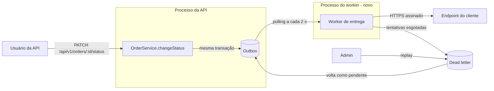

# RFC: Sistema de Webhooks de Notificação de Pedidos

## Metadados

| Campo | Valor |
|---|---|
| **Autora** | Larissa (Tech Lead) |
| **Status** | Em revisão |
| **Data** | 2026-11-27 |
| **Revisores** | Marcos (PM) — escopo e prazo · Bruno (Eng. Pleno, Pedidos) — integração com `orders` · Diego (Eng. Sênior, Plataforma) — outbox e worker · Sofia (Segurança) — HMAC e gestão de secrets |
| **Origem** | Reunião técnica de quinta-feira, 09:00 (`TRANSCRICAO.md`) |
| **Documentos relacionados** | [PRD](./PRD.md) · [FDD](./FDD.md) · [ADRs](./adrs/README.md) |

---

## 1. Resumo (TL;DR)

Propomos notificar clientes B2B, por **webhooks de saída**, sempre que o status de um pedido muda. O evento é gravado em uma tabela **outbox no MySQL, na mesma transação** da mudança de status ([ADR-001](./adrs/ADR-001-outbox-no-mysql.md)), e entregue por um **worker em processo separado com polling de 2 s** ([ADR-002](./adrs/ADR-002-worker-separado-com-polling.md)). Cada entrega é **assinada com HMAC-SHA256** usando uma secret por endpoint ([ADR-004](./adrs/ADR-004-autenticacao-hmac-sha256-por-endpoint.md)); falhas seguem **retry com backoff de 1m a 12h e DLQ** ([ADR-003](./adrs/ADR-003-retry-backoff-exponencial-e-dlq.md)); a garantia é **at-least-once com `X-Event-Id`** para deduplicação ([ADR-005](./adrs/ADR-005-entrega-at-least-once-com-event-id.md)). Tudo sobre o MySQL e os padrões já existentes, **sem infraestrutura nova** ([ADR-006](./adrs/ADR-006-reuso-dos-padroes-do-projeto.md)).

## 2. Contexto e problema

Atlas Comercial, MaxDistribuição e Nova Cargo pediram formalmente para ser notificados em tempo real quando o status dos seus pedidos muda ([09:00] Marcos). Hoje eles fazem polling periódico no `GET /orders` (`src/modules/orders/order.routes.ts`), o que torna a integração "lenta e cara" para eles ([09:00] Marcos). Para os clientes, "tempo real" é **qualquer coisa abaixo de 10 segundos** ([09:02] Marcos).

Há pressão de prazo: a Atlas sinalizou que pode migrar para um concorrente se não houver entrega até o fim do trimestre ([09:00] Marcos) e pediu a feature para o fim de novembro ([09:45] Marcos).

O sistema atual não tem nenhum mecanismo de notificação externa, eventos ou filas. Toda mudança de status passa por `OrderService.changeStatus` (`src/modules/orders/order.service.ts`), que executa em uma única transação a validação da máquina de estados, o ajuste de estoque, o update do pedido e o registro em `order_status_history` — uma transação "já pesada" ([09:04] Bruno).

**Restrições que moldam a proposta:**

- Somente webhooks **de saída**; os clientes querem receber, não enviar ([09:02] Marcos, [09:03] Sofia).
- **Não pode existir** mudança de status sem evento correspondente ([09:40] Bruno).
- Time pequeno: nada de infraestrutura nova sem necessidade ([09:07] Diego).

## 3. Proposta técnica

**3.1 Captura do evento.** Dentro da transação do `changeStatus`, depois do registro no histórico, uma função `publishWebhookEvent(tx, order, fromStatus, toStatus)` grava o evento na outbox ([09:41] Bruno). O payload é gravado já renderizado, como snapshot do momento da transição ([ADR-007](./adrs/ADR-007-snapshot-do-payload-na-insercao.md)). Só se grava evento se algum webhook ativo do cliente quer aquele status ([09:34] Bruno). Falha na gravação desfaz a mudança de status ([09:40] Bruno).

**3.2 Entrega.** Um worker em processo próprio, com entry-point nova e instância própria do Prisma, busca a cada 2 s os eventos pendentes mais antigos em lotes pequenos e faz o POST para o endpoint do cliente ([09:09] Diego, [09:11] Larissa, [09:30] Bruno). Nesta fase roda **um único worker** ([09:12] Diego).

**3.3 Falhas.** Sem resposta de sucesso (incluindo timeout de 10 s, [09:42] Diego), o evento é reagendado com backoff de 1m/5m/30m/2h/12h ([09:17] Larissa); esgotadas as tentativas, vai para uma DLQ em tabela própria, de onde um administrador pode reprocessá-lo manualmente ([09:18] Diego, [09:36] Sofia).

**3.4 Segurança.** Cada endpoint tem sua própria secret, gerada pela plataforma e rotacionável com 24 h de convivência entre a antiga e a nova; o corpo de cada envio é assinado com HMAC-SHA256 ([09:22] Sofia). URLs precisam ser `https` ([09:23] Sofia).

**3.5 Semântica de entrega.** At-least-once: duplicatas são possíveis e o cliente deduplica pelo `X-Event-Id` ([09:26] Larissa). A ordem só é garantida por pedido e enquanto houver um único worker ([09:13] Larissa).

**3.6 Superfície e código.** Um novo módulo `src/modules/webhooks/` **(novo, a criar)**, no padrão dos módulos existentes, expõe o cadastro e a manutenção de webhooks, a rotação de secret, o histórico de entregas e o replay administrativo; erros seguem `AppError` com prefixo `WEBHOOK_` ([09:30] Larissa). Contratos, payload, headers, modelo de dados e matriz de erros estão no [FDD](./FDD.md).

## 4. Alternativas consideradas

Alternativas de nível arquitetural. Variações de parâmetro (número de tentativas, onde guardar a DLQ, como montar o payload) estão nos ADRs.

| ID | Alternativa | Trade-off que levou ao descarte | Origem | ADR |
|---|---|---|---|---|
| RFC-ALT-01 | Envio HTTP **síncrono** dentro do `changeStatus` | Cliente lento travaria mudanças de status de outros pedidos; cliente fora do ar forçaria rollback do status ou perda do evento | [09:04] Bruno, [09:06] Diego | [ADR-001](./adrs/ADR-001-outbox-no-mysql.md) |
| RFC-ALT-02 | **Redis Streams** ou outro broker | Exige subir e operar infraestrutura nova; "overengineering" para um time pequeno, e a publicação não participaria da transação MySQL | [09:07] Larissa, [09:07] Diego | [ADR-001](./adrs/ADR-001-outbox-no-mysql.md) |
| RFC-ALT-03 | **Trigger no banco** para acordar o worker | MySQL não notifica processo externo (não há `NOTIFY/LISTEN`); exigiria gambiarra via arquivo ou endpoint; polling de 2 s já atende | [09:09] Bruno, [09:09] Diego | [ADR-002](./adrs/ADR-002-worker-separado-com-polling.md) |
| RFC-ALT-04 | Worker **no mesmo processo da API** | Reinício ou deploy da API derrubaria as entregas | [09:11] Diego | [ADR-002](./adrs/ADR-002-worker-separado-com-polling.md) |
| RFC-ALT-05 | Garantia **exactly-once** | Exigiria coordenação dos dois lados; muito mais complexo que at-least-once com `event_id`, padrão de mercado | [09:25] Diego | [ADR-005](./adrs/ADR-005-entrega-at-least-once-com-event-id.md) |
| RFC-ALT-06 | **Secret global** da plataforma | "Se vaza uma, vaza tudo" — um vazamento comprometeria todos os clientes | [09:21] Sofia | [ADR-004](./adrs/ADR-004-autenticacao-hmac-sha256-por-endpoint.md) |

## 5. Questões em aberto

### 5.1 Levantadas na reunião e não decididas

| ID | Questão | Situação atual | Quem decide |
|---|---|---|---|
| RFC-OQ-01 | **Rate limiting de saída por cliente** — 50 pedidos mudando de status em um minuto viram 50 chamadas | Fora do escopo; "observar e decidir depois" ([09:38]–[09:39] Diego, [09:39] Larissa) | Larissa e Diego, com dados de produção |
| RFC-OQ-02 | **Escala para múltiplos workers** sem perder a ordem por pedido | Single-worker nesta fase; opções futuras: particionar por `order_id` ou lock pessimista ([09:13] Diego, [09:13] Larissa) | Diego, quando o throughput exigir |
| RFC-OQ-03 | **Restringir o CRUD de webhooks** | Liberado para qualquer usuário autenticado "por enquanto" ([09:37] Sofia). Agravante: `prisma/schema.prisma` não relaciona `User` a `Customer`, então hoje não há como verificar se o usuário "representa" o cliente ([09:32] Marcos) | Sofia |

### 5.2 Identificadas na análise (não discutidas na reunião)

| ID | Questão | Proposta para discussão | Quem decide |
|---|---|---|---|
| RFC-OQ-04 | **Retentativas versus ordem por pedido** — enquanto um evento aguarda retry, um evento posterior do mesmo pedido pode ser entregue antes, contrariando a ordem prometida em 3.5 | (a) segurar eventos posteriores do mesmo pedido enquanto houver anterior pendente, aceitando mais atraso; ou (b) aceitar e documentar, com o cliente usando `from_status`/`to_status` e o timestamp | Diego e Bruno |
| RFC-OQ-05 | **Assinatura durante a janela de rotação** — como o cliente valida com a secret antiga *ou* a nova durante as 24 h ([09:21] Sofia) | Enviar duas assinaturas no período de convivência | Sofia, na revisão de segurança ([09:46] Sofia) |
| RFC-OQ-06 | **Onde aplicar o limite de 64 KB** ([09:24] Larissa) — erro na gravação da outbox desfaria a mudança de status do pedido ([09:40] Bruno) | Validar no worker, antes do envio, e mandar o evento direto para a DLQ | Larissa e Sofia |

### 5.3 Adiado para fases futuras (não faz parte desta proposta)

- Aviso por e-mail ao cliente com falhas repetidas — próxima fase, "depois que a gente medir o impacto" ([09:37] Larissa).
- Dashboard visual para o cliente — projeto separado do time de frontend ([09:40] Larissa).
- Arquivamento de eventos entregues após ~30 dias ([09:08] Diego).

## 6. Impacto e riscos

### 6.1 Impacto

| Área | Impacto |
|---|---|
| Módulo de pedidos | Uma chamada nova dentro da transação do `changeStatus` (`src/modules/orders/order.service.ts`); construtor e rotas inalterados |
| Operação | Um novo processo para implantar e supervisionar, além da API (`src/server.ts` serve de modelo) |
| Banco de dados | Novas tabelas para configuração, outbox, histórico de entregas e DLQ (modelo no FDD) |
| Segurança | Revisão dedicada de HMAC e geração de secret, com pelo menos dois dias úteis antes do deploy ([09:46] Sofia) |
| Clientes | Precisam verificar a assinatura e deduplicar por `X-Event-Id`; semântica documentada no portal do desenvolvedor ([09:26] Marcos) |
| Cronograma | Estimativa de três sprints, incluindo a revisão de segurança ([09:46]–[09:47] Larissa) |

### 6.2 Riscos

| ID | Risco | Mitigação |
|---|---|---|
| RFC-RISK-01 | Falha ao gravar na outbox passa a **bloquear a mudança de status** do pedido | Gravação simples e indexada; testes de rollback; limite de 64 KB fora da transação (RFC-OQ-06) |
| RFC-RISK-02 | **Worker único** parado atrasa todas as entregas (os eventos ficam seguros na outbox) | Supervisão do processo e alerta pela idade do evento pendente mais antigo (proposta no FDD) |
| RFC-RISK-03 | Eventos **presos em "processando"** se o worker cair no meio de um lote | Devolver ao estado pendente após um tempo limite (proposta no FDD) |
| RFC-RISK-04 | **Vazamento de secret** — ela precisa ser recuperável para assinar, e o `redact` do logger (`src/shared/logger/index.ts`) não cobre secrets | Estender o `redact`; rotação com 24 h ([09:21] Sofia); revisão de segurança ([09:46] Sofia) |
| RFC-RISK-05 | Cliente **não deduplica** e processa o mesmo evento duas vezes | Destaque no portal do desenvolvedor ([09:26] Marcos); `X-Event-Id` estável inclusive no replay |
| RFC-RISK-06 | **DLQ cresce sem acompanhamento**, e o cliente não é avisado (e-mail adiado, [09:37] Larissa) | Monitorar o tamanho da DLQ (proposta no FDD); replay manual por admin |
| RFC-RISK-07 | **Autorização ampla**: qualquer usuário autenticado gerencia webhooks de qualquer cliente | Tratar em RFC-OQ-03; auditar alterações via logs |
| RFC-RISK-08 | **Prazo**: pedido para o fim de novembro ([09:45] Marcos) contra estimativa de três sprints ([09:47] Larissa) | Marcos confirma o prazo com a Atlas ([09:47] Marcos) |

## 7. Decisões relacionadas

| ADR | Decisão |
|---|---|
| [ADR-001](./adrs/ADR-001-outbox-no-mysql.md) | Outbox no MySQL, na mesma transação do `changeStatus` |
| [ADR-002](./adrs/ADR-002-worker-separado-com-polling.md) | Worker em processo separado, polling de 2 s, single-worker |
| [ADR-003](./adrs/ADR-003-retry-backoff-exponencial-e-dlq.md) | Retry com backoff 1m/5m/30m/2h/12h e DLQ em tabela separada |
| [ADR-004](./adrs/ADR-004-autenticacao-hmac-sha256-por-endpoint.md) | HMAC-SHA256, secret por endpoint, rotação com 24 h de convivência |
| [ADR-005](./adrs/ADR-005-entrega-at-least-once-com-event-id.md) | At-least-once com deduplicação via `X-Event-Id` |
| [ADR-006](./adrs/ADR-006-reuso-dos-padroes-do-projeto.md) | Reuso dos padrões existentes do projeto |
| [ADR-007](./adrs/ADR-007-snapshot-do-payload-na-insercao.md) | Snapshot do payload na inserção da outbox |

## 8. Próximos passos

1. Sessão de revisão deste RFC com Bruno e Diego antes de começar a codar ([09:50] Larissa).
2. Encaminhar RFC-OQ-03, RFC-OQ-05 e RFC-OQ-06 para a revisão de segurança da Sofia ([09:46] Sofia).
3. Detalhar contratos, modelo de dados, fluxos e erros no [FDD](./FDD.md).
